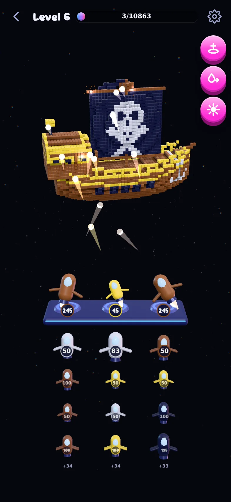
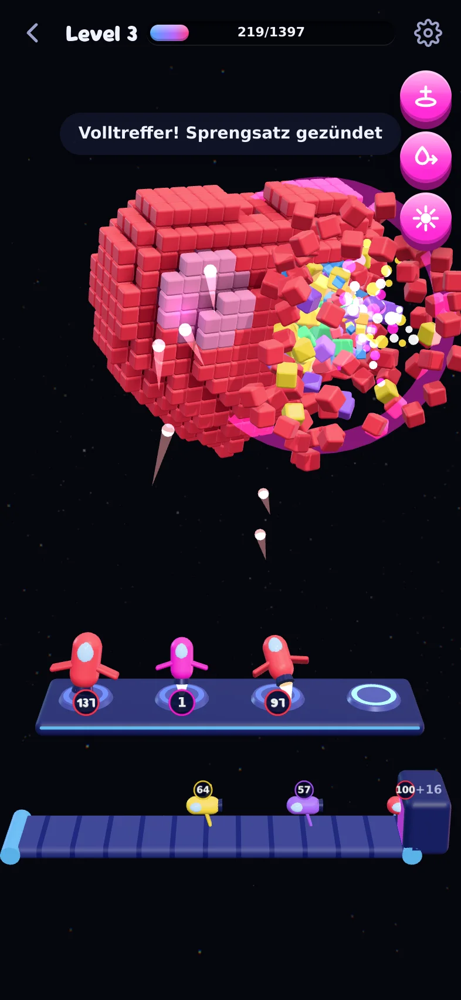

  

<b>Crack the core – color by color.</b>

  

corepop is a free color-sorting puzzle game in 3D. A figure made of candy-colored cubes floats in space – a football, a heart, a pirate ship … – and under its skin sits a colorful core, layered like a lollipop. Your spaceships take it apart, layer by layer:

- **Tap a ship on the conveyor belt** – it flies to a free landing pad and only hits blocks of **its own color** that lie **on the very outside**. If there are none, it blocks its pad. All pads blocked: game over.
- **Watch the belt** – it keeps moving, and whatever falls off the end is gone. There is only a little spare ammo: if a ship you still need drops off, the level is lost.
- **Blast crystals** – pulsing magenta cubes hidden in the inner layers. Hit one with a bomber and it explodes: the energy fades with distance and every cube in between, the blown-off cubes tumble into space one by one, bounce off the figure and fade into the dark.

  
  &nbsp;
  

18 handmade figures in comic style, with three bosses of over 10,000 cubes each (a pirate ship, a tank and a faceted mask whose eyes are explosive crystals), up to three stars per level, unlockable specials (extra pad, recolor, supernova) and ship designs (paper plane, gummy bear, retro rocket, mini UFO). No sign-up, no ads, no tracking – progress stays in the browser. Languages: German and English.

## Built with

corepop is built on great open-source projects. Thanks to everyone who contributes to them!

### In the game

| Project | Used for | License |
|---|---|---|
| [three.js](https://threejs.org) | 3D rendering | MIT |
| [Tone.js](https://tonejs.github.io) | Music and sound effects, synthesized live | MIT |

### Font

| Project | Used for | License |
|---|---|---|
| [Sour Gummy](https://fonts.google.com/specimen/Sour+Gummy) | Logo lettering | OFL-1.1 |

### For building

| Project | Used for | License |
|---|---|---|
| [Astro](https://astro.build) | Generates the pages as static HTML | MIT |
| [Tailwind CSS](https://tailwindcss.com) | Styling (CSS) | MIT |
| [Vitest](https://vitest.dev) | Automated tests of the game logic | MIT |

---

Designed with ❤️. Powered by Claude.

